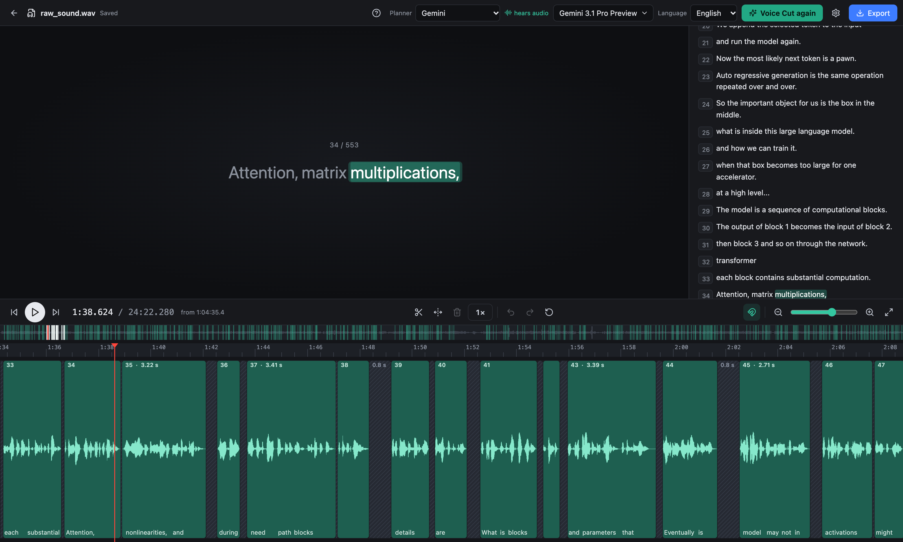

# VoiceCut — automatic narration editing for content creators

[](LICENSE)
[](pyproject.toml)
[](#requirements)
[](#requirements)

VoiceCut turns retake-heavy narration into a clean audio or video edit. It
finds false starts, repeated takes, corrections, and recording directions,
keeps the best take of every sentence, removes breaths, and gives every pause a
natural length. Then it opens the result in its editor, where you can fix
anything by hand before exporting. VoiceCut never synthesizes replacement
speech: every sound in the edit comes from your recording.



The project is in beta and currently targets narrated, single-speaker
recordings on Apple Silicon Macs.

## Examples

[**See examples →**](https://vectozavr.github.io/voicecut/)

## Quick start

### Requirements

- Apple Silicon Mac running macOS
- Python 3.11 or 3.12
- Homebrew (the installer uses it for FFmpeg, micromamba, and Node.js)
- English or Russian single-speaker narration
- An API key for the planner; Gemini is the default

### Install

The installer sets up FFmpeg, MLX Whisper, Montreal Forced Aligner 3.4.1, the
editor, and the isolated runtimes used by VoiceCut:

```bash
git clone https://github.com/vectozavr/voicecut.git
cd voicecut
./scripts/install.sh
source .venv/bin/activate
```

See the [installation guide](docs/installation.md) for first-run model
downloads and manual setup.

### Edit in the browser

```bash
voicecut-editor                 # opens http://127.0.0.1:8765 in your browser
voicecut-editor recording.wav   # or open a recording right away
```

1. **Import** a recording: WAV, MP3, M4A, FLAC, MOV, MP4, and other common
   formats. Video works too.
2. Open **Settings** (the gear) and paste your Gemini, OpenAI, or DeepSeek API
   key. Keys are checked with the provider and saved to `.env`.
3. Pick the **planner**, the **model** (the list comes live from the provider),
   and the **language**, then press **Voice Cut**. The pipeline runs locally
   with live stage progress; only the planner request goes to the cloud.
4. **Correct the edit.** Every clip references the original recording:
   - drag a clip edge to bring back removed material or trim it, and later
     clips follow;
   - drag a pause edge to make it longer or shorter, or press `P` to insert a
     1-second pause at the playhead;
   - split with `S`, delete, undo and redo;
   - listen at 0.5× to 2.5× with the `1×` button, at the same pitch, while the
     caption highlights every word.
5. **Export** audio or video. The preview is rendered by the same code as the
   export, so what you hear in the editor is what you get.

The editor is developed and tested in Chromium-based browsers (Chrome, Edge,
Arc, Brave). See the [editor guide](docs/editor.md) for every shortcut and
option.

### Use the command line

The same pipeline runs without the editor. Add the planner key to `.env`:

```dotenv
GEMINI_API_KEY=your_key_here
```

Then run VoiceCut with only the input file:

```bash
voicecut recording.wav
```

The result is written beside the input as `recording_edited.wav`. VoiceCut
keeps a supported input container by default and accepts common formats via
FFmpeg, including WAV, MP3, M4A, FLAC, MOV, and MP4. Uncommon audio containers
default to WAV; recognized video inputs default to MP4 when needed.

Useful variants:

```bash
# Choose the output path.
voicecut recording.mp3 -o final.mp3

# Edit Russian narration.
voicecut recording_ru.wav --language ru

# Edit video from its speech track.
voicecut presentation.mp4 -o presentation_cut.mp4

# Keep reusable diagnostics and stage metadata.
voicecut recording.wav --work-dir voicecut_work --debug-artifacts
```

An existing output is never overwritten unless `--overwrite` is supplied.

## How it works


1. **Build one source transcript.** MLX Whisper transcribes every speech
   region of the recording. Any speech that no word covers is transcribed
   again on its own, because Whisper likes to skip repeated phrases. English
   can add narrowly gated hidden-retry evidence.
2. **Select the takes like an editor.** The planner sees about four minutes of
   transcript at a time plus two minutes of look-ahead, and with Gemini also
   hears that audio. It returns the word ranges of the final narration and the
   pause after each sentence, and it can revoke a recent choice when a better
   retake appears. A final review re-decides any place where the edit still
   repeats itself.
3. **Find where words really start and stop.** Montreal Forced Aligner maps the
   kept words to the sound; the waveform energy then decides where each word's
   sound, including its natural decay, begins and ends. A cut never lands
   inside audible speech.
4. **Normalize every pause.** Gaps at cuts and inside kept takes get a length
   for their class (phrase, comma, sentence, paragraph); breaths and clicks
   inside pauses are replaced by clean room tone from the same recording.
5. **Render once.** Retained speech is copied sample-exact and joined with short
   crossfades placed in silence; video follows the same source intervals with
   direct picture cuts.
6. **Correct in the editor.** The editor shows that plan as clips and pauses
   over the original recording and re-renders your changes with the same
   renderer.

Breath and noise removal is on by default for English; disable it with
`--breath-cleanup off`. Russian defaults to off because the Respiro-en breath
detector has not been validated for Russian.

Read the [architecture guide](docs/architecture.md) for the invariants and
artifact flow.

## Why VoiceCut is different

- **Semantic editing, not silence trimming.** It can distinguish a corrected
  take from a fluent but abandoned attempt.
- **Source-grounded decisions.** Every retained phrase maps back to exact word
  occurrences in the recording.
- **Speech-safe joins.** MFA identifies the words; the waveform decides where
  their sound ends, so words are not clipped and their decay is kept.
- **One boundary plan, one render.** Retained speech is not repeatedly cut,
  faded, and re-rendered by sequential cleanup stages.
- **Audio and video.** The same narration decision can publish a common audio
  format or a directly cut video.
- **Inspectable output.** A persistent work directory contains the transcript,
  semantic plan, alignment evidence, final boundary plan, and run summary.

## Planner backends

Cloud planners receive the transcript of each planning window. Gemini also
receives, by default, a compressed 16 kHz mono copy of that window's audio so
it can hear stumbles and correct mis-heard words; pass `--planner-audio off` to
send text only. The original file and any video never leave the machine, and
transcription, alignment, and rendering stay local.

| Backend | Default model | Credential | Status |
| --- | --- | --- | --- |
| Gemini | `gemini-3.1-pro-preview` | `GEMINI_API_KEY` | Recommended |
| OpenAI | `gpt-5-mini` | `OPENAI_API_KEY` | Supported |
| DeepSeek | `deepseek-v4-flash` | `DEEPSEEK_API_KEY` | Supported |
| Qwen / Gemma / custom MLX-LM | configurable local model | none | Experimental |

Select a backend or model explicitly when needed:

```bash
voicecut recording.wav --planner-backend openai
voicecut recording.wav --planner-backend gemini --planner-model gemini-3.8-flash
voicecut recording.wav --planner-backend gemma \
  --planner-model mlx-community/gemma-3-12b-it-4bit
```

Local planners are available for evaluation but are not yet the recommended
production path. See [configuration](docs/configuration.md) for every backend,
environment variable, and advanced option.

## Reliability and graceful degradation

VoiceCut validates the structure of every planner answer and retries invalid or
failed requests. Every request is cached by its exact content, so an
interrupted long recording resumes where it stopped. Places where the edit may
still repeat itself after the review are reported as warnings. If MFA is
unavailable, cuts use Whisper timing refined by the waveform; if the breath
detector fails, pauses are cleaned by waveform energy alone. Both cases are
recorded in the run manifest.

## Current limitations

- macOS on Apple Silicon is the supported platform today.
- VoiceCut is designed for one main narrator, not overlapping conversation or
  multi-camera visual editing.
- English and Russian are supported; language selection is explicit.
- Video is edited from speech timing only. VoiceCut does not understand visual
  continuity, slides, gestures, or camera changes.
- LLM planning is probabilistic and may occasionally select the wrong take.
- A cut inside tightly connected speech (no pause between a kept and a
  removed word) relies on MFA's phone boundary and can occasionally sound
  abrupt. Review every final export before publication.
- Local Qwen/Gemma planning remains experimental.
- The first run downloads several model assets and can take time.

## Documentation

| Guide | Contents |
| --- | --- |
| [Installation](docs/installation.md) | Supported setup, first-run downloads, and manual installation |
| [Editor](docs/editor.md) | Browser editor: import, Voice Cut, clips and pauses, shortcuts, settings, export |
| [Examples](examples/README.md) | Exact commands, media files, and reproduction workflow |
| [Architecture](docs/architecture.md) | Production call graph, safety invariants, and manifests |
| [Configuration](docs/configuration.md) | Planner backends, languages, caching, and CLI options |
| [Troubleshooting](docs/troubleshooting.md) | Installation, model, long-recording, and media errors |
| [Contributing](CONTRIBUTING.md) | Development environment, tests, and contribution scope |
| [Credits](docs/credits.md) | Upstream projects, models, and licenses |

## Development

```bash
.venv/bin/python -m pytest -q
ruff check src tests
ruff format --check src tests
```

Frontend checks for the editor:

```bash
cd frontend
npm run typecheck
npm test
npm run build
```

VoiceCut's tests use small fixtures and mocked external model responses; they
do not download MFA or Respiro-en during normal CI-style runs.

## Built with

VoiceCut builds on
[MLX Whisper](https://github.com/ml-explore/mlx-examples/tree/main/whisper),
[WhisperX](https://github.com/m-bain/whisperX),
[Montreal Forced Aligner](https://montreal-forced-aligner.readthedocs.io/),
[Respiro-en](https://github.com/ydqmkkx/Respiro-en),
[Silero VAD](https://github.com/snakers4/silero-vad), and
[FFmpeg](https://ffmpeg.org/), together with the selected planner provider.
See [credits and licensing details](docs/credits.md).

## Star history

[](https://github.com/vectozavr/voicecut)

## License

VoiceCut is released under the [MIT License](LICENSE). Third-party models and
components retain their own licenses; see [docs/credits.md](docs/credits.md).
