

  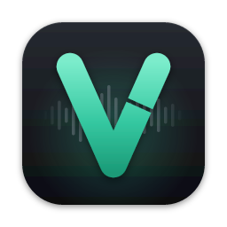

<h1 align="center">VoiceCut</h1>

  <strong>Record with all your retakes. Get back one clean take.</strong> 
  A free desktop app that edits narration for you: it keeps the best take of
  every line, drops false starts, repeats and recording directions, cleans up
  breaths and gives every pause a natural length. Then you fine-tune every
  cut on a timeline and export audio or video.

  

  
  
  
  

  <a href="https://vectozavr.github.io/voicecut/">Website</a> ·
  <a href="#install">Install</a> ·
  <a href="https://vectozavr.github.io/voicecut/#examples">Listen to examples</a> ·
  <a href="#how-it-works">How it works</a> ·
  <a href="docs/development.md">Build from source</a>

<picture>
  <source media="(prefers-color-scheme: dark)" srcset="docs/assets/screenshots/editor-dark.webp">
  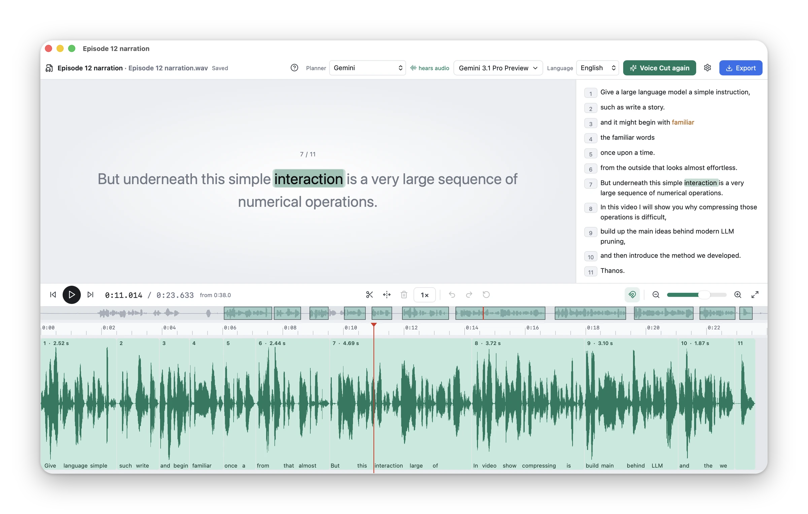
</picture>

## What VoiceCut does

You record the way people really talk: a sentence, a stumble, the same
sentence again, "let me start over", a better version. VoiceCut listens to
the whole recording and edits it the way a human editor would.

- **Keeps the best take of every line.** It tells a corrected retake from a
  fluent but abandoned attempt, and drops the abandoned one.
- **Cuts only where it is silent.** Every cut lands between words, never
  inside one, and keeps each word's natural decay.
- **Gives every pause a natural length.** Breaths and clicks inside pauses
  become clean room tone from your own recording.
- **Never fakes your voice.** Nothing is synthesized: every sound in the
  edit comes from your recording.
- **Edits video too.** The picture follows the kept speech with direct cuts.
- **Leaves the last word to you.** The automatic edit opens as clips on a
  timeline over the original recording, ready to adjust.
- **Runs on your computer.** Transcription, alignment and rendering are
  local; only the planner request goes to the cloud (see
  [Planners](#planners)).

## A quick tour

### Start a project

Drop a recording on the window or choose **New Project…**: WAV, MP3, M4A,
FLAC, MOV, MP4 and other common formats. Each project is saved as one `.vc`
document that you open from the Finder, your file manager or Explorer.

<picture>
  <source media="(prefers-color-scheme: dark)" srcset="docs/assets/screenshots/start-dark.webp">
  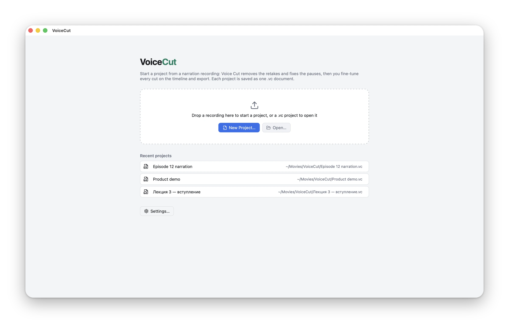
</picture>

### Press Voice Cut

Pick the planner, its model and the language in the toolbar, then press
**Voice Cut**. Every stage shows its progress, and a long recording that was
interrupted picks up where it stopped.

<picture>
  <source media="(prefers-color-scheme: dark)" srcset="docs/assets/screenshots/voice-cut-run-dark.webp">
  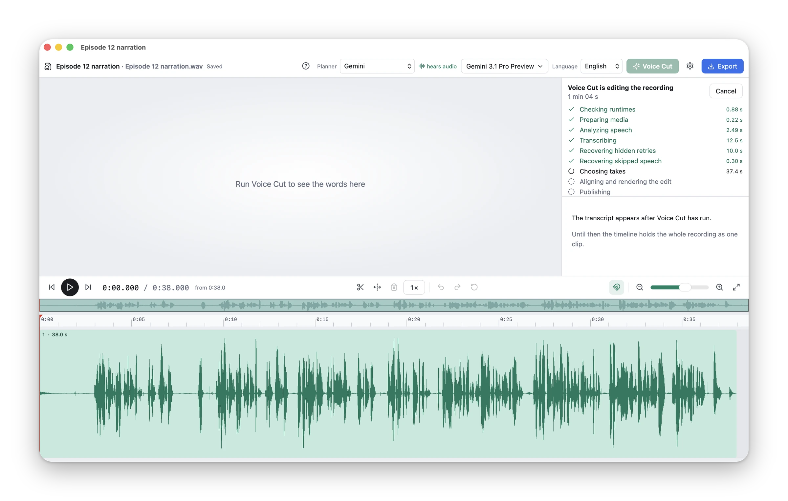
</picture>

### Fine-tune every cut

The edit appears as clips and pauses over the original recording. Every clip
still references the source, so nothing is lost:

- drag a clip edge to bring back removed material or trim it — later clips
  follow;
- drag a pause edge to make it longer or shorter, or press `P` to insert one;
- split with `S`, delete, undo and redo;
- listen at 0.5× to 2.5× at the same pitch while the caption highlights each
  word, and click any word in the text to jump to it.

The preview is rendered by the same code as the export, so what you hear is
exactly what you get. The [editor guide](docs/editor.md) lists every shortcut.

### Video works the same way

<picture>
  <source media="(prefers-color-scheme: dark)" srcset="docs/assets/screenshots/video-dark.webp">
  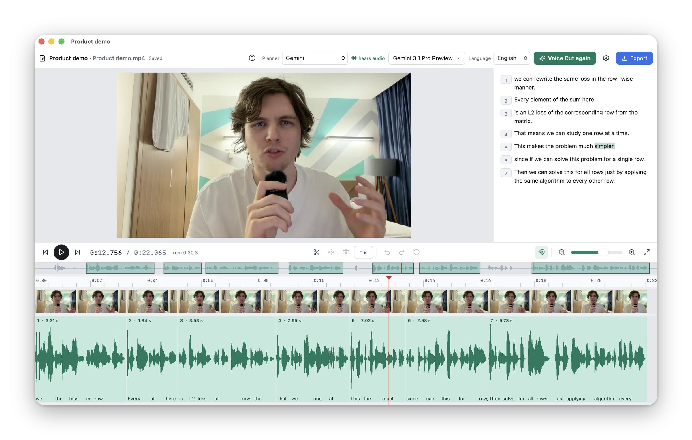
</picture>

### Export

Export MP4 or MOV video (H.264), or WAV (24-bit), FLAC, AAC (`.m4a`) or MP3
audio. An unchanged Voice Cut edit exports exactly the sound of the preview.

<picture>
  <source media="(prefers-color-scheme: dark)" srcset="docs/assets/screenshots/export-dark.webp">
  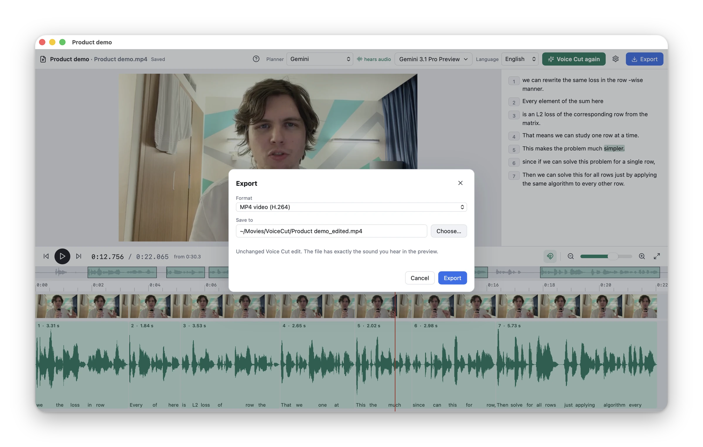
</picture>

## Install

Download the installer for your system from the
[latest release](https://github.com/vectozavr/voicecut/releases/latest) — or
open the [website](https://vectozavr.github.io/voicecut/), which picks the
right one for you.

| System | Download | Then |
| --- | --- | --- |
| **macOS** 14 Sonoma or later, Apple Silicon or Intel | `VoiceCut-<version>-universal.dmg` | Open it and drag VoiceCut to Applications. |
| **Windows** 10 or 11, x64 | `VoiceCut-<version>-x64-setup.exe` | Run it. It installs for you alone, no administrator needed. |
| **Linux** x86_64 with glibc 2.35+ (Ubuntu 22.04, Debian 12, Fedora 36 or newer) | `VoiceCut-<version>-x86_64.AppImage` | `chmod +x` it and run it. It adds itself to your applications. |
| **Debian, Ubuntu** | `VoiceCut-<version>-amd64.deb` | `sudo apt install ./VoiceCut-<version>-amd64.deb` |

The release also lists `VoiceCut-<version>-universal.app.tar.gz` and
`latest.json`: installed apps download them to update themselves; you don't
need them.

The AppImage needs FUSE 2. If it does not start on Ubuntu, install it with
`sudo apt install libfuse2` (`libfuse2t64` on Ubuntu 24.04 and later).

### Opening it the first time

The installers are not signed with paid certificates yet, so the first
launch of a downloaded copy shows a warning once:

- **macOS** says VoiceCut cannot be opened because Apple cannot check it for
  malicious software. Close the message, open **System Settings › Privacy &
  Security**, scroll down and choose **Open Anyway**, then confirm. (Or run
  `xattr -dr com.apple.quarantine /Applications/VoiceCut.app` once.)
- **Windows** SmartScreen says it protected your PC. Choose **More info** ›
  **Run anyway**.
- **Linux** has no such step.

Then VoiceCut shows what it needs and installs its engine with one click:
Python, PyTorch, Whisper, the Montreal Forced Aligner, FFmpeg and — unless
you have it already — [Ollama](https://ollama.com) for planners that run on
your computer. That is about 1.7 GB to download on a Mac and 2.9 GB on
Windows and Linux, once, and about 4–5 GB on disk (keep up to 9 GB free while
it installs). The speech models, about 2 GB more, download the first time
you run Voice Cut.

<picture>
  <source media="(prefers-color-scheme: dark)" srcset="docs/assets/screenshots/setup-dark.webp">
  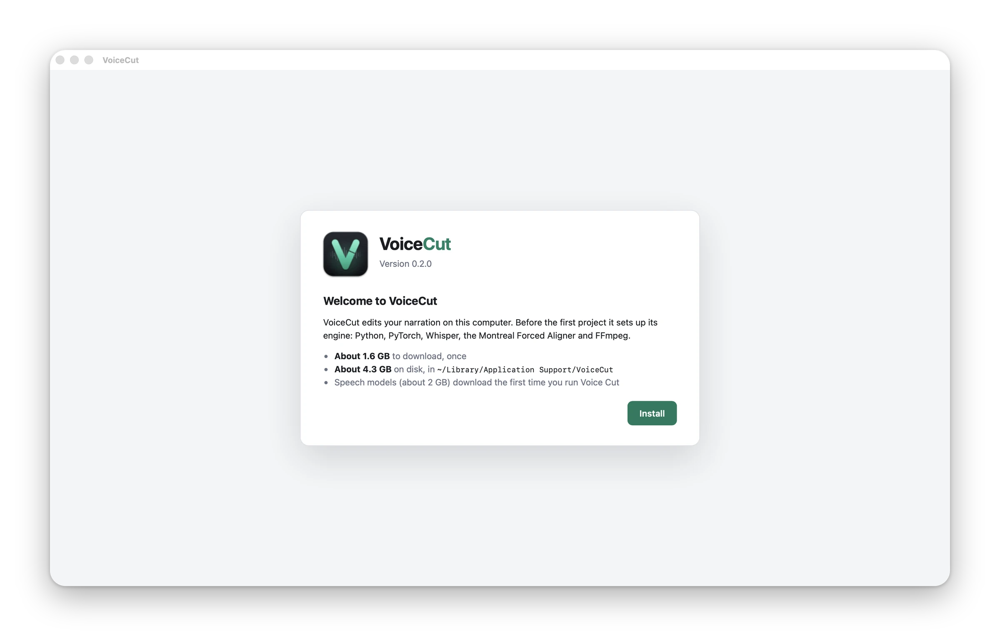
</picture>

Last, open **Settings** and paste a planner API key — a
[Gemini key](https://aistudio.google.com/apikey) is all you need to start.
VoiceCut keeps it in the macOS Keychain, the Windows Credential Manager or
your Linux keyring, never in your projects.

Whisper runs on the GPU on Apple Silicon and on NVIDIA GPUs with a recent
driver (CUDA 12); anywhere else it runs on the CPU, roughly as fast as the
recording plays.

### Updates

VoiceCut updates itself. When a new version is out, a download button
appears in the toolbar; by default the update downloads in the background
and installs when you quit VoiceCut, and your open projects come back after
the restart. Turn that off in **Settings › Updates** to install only from
the button. On Debian and Ubuntu the update asks for your password.

## Planners

The planner is the language model that reads the transcript and chooses the
takes. Pick it in the toolbar; the list of models comes live from the
provider, and you can type any other model name.

<picture>
  <source media="(prefers-color-scheme: dark)" srcset="docs/assets/screenshots/planner-models-dark.webp">
  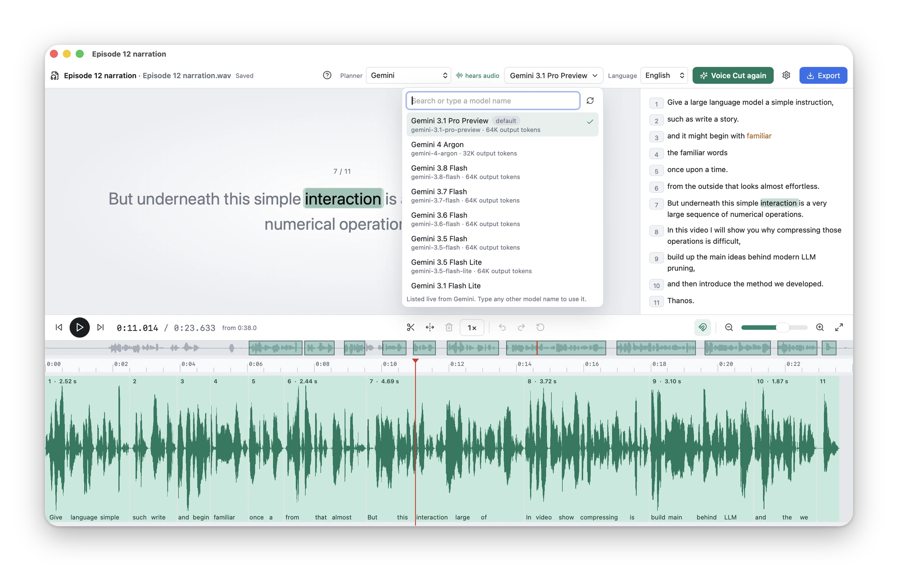
</picture>

| Planner | Default model | What it receives | Status |
| --- | --- | --- | --- |
| **Gemini** | `gemini-3.8-flash` | the transcript of each planning window and that window's audio | Recommended |
| **OpenRouter** | `google/gemma-4-31b-it` | the transcript of each planning window | Supported; the cheapest |
| **OpenAI** | `gpt-5-mini` | the transcript of each planning window | Supported |
| **DeepSeek** | `deepseek-v4-flash` | the transcript of each planning window | Supported |
| **Local (Ollama)** | Gemma 4 31B, on your computer | nothing leaves the computer | Supported; needs a fast computer |

Gemini models **hear audio**: they receive a compressed 16 kHz mono copy of
each window, so they can hear stumbles and fix mis-heard words. Your original
file and any video never leave the computer. Keys are added in **Settings**,
each with a link to get one, and are sent only to their own provider.

The defaults come from a comparison on a 64-minute narration, scored against
Gemini 3.1 Pro listening to the audio. Gemini 3.8 Flash made nearly the same
edit (removed-word F1 0.98) for about a fifth of the price, roughly $1 per hour of
recording. Gemma 4 31B through [OpenRouter](https://openrouter.ai) came close
(0.92) for about three cents, reading the transcript only. Any other model of
the provider's live list can be chosen instead. Gemma is not offered through
the Gemini key: the Gemini API meters it at 16,000 input tokens a minute.

**Local** planners run open models on your Mac or PC through Ollama, on
macOS, Windows and Linux alike, so nothing leaves the computer. The model list
shows VoiceCut's two recommendations first — Gemma 4 31B, which planned best
in our comparison with Gemini, and Qwen 3.8 27B — then the other models your
Ollama has; choose one and it downloads (about 18–20 GB) with its progress.
Any other model of the [Ollama library](https://ollama.com/library) can be
typed in. Each model has a **Reasoning** switch (off, on, or a level): the
recommended ones start with the setting that planned best. **Settings ›
Local models** lists them too and deletes them. If you already use Ollama,
VoiceCut uses yours and its models.

<picture>
  <source media="(prefers-color-scheme: dark)" srcset="docs/assets/screenshots/settings-dark.webp">
  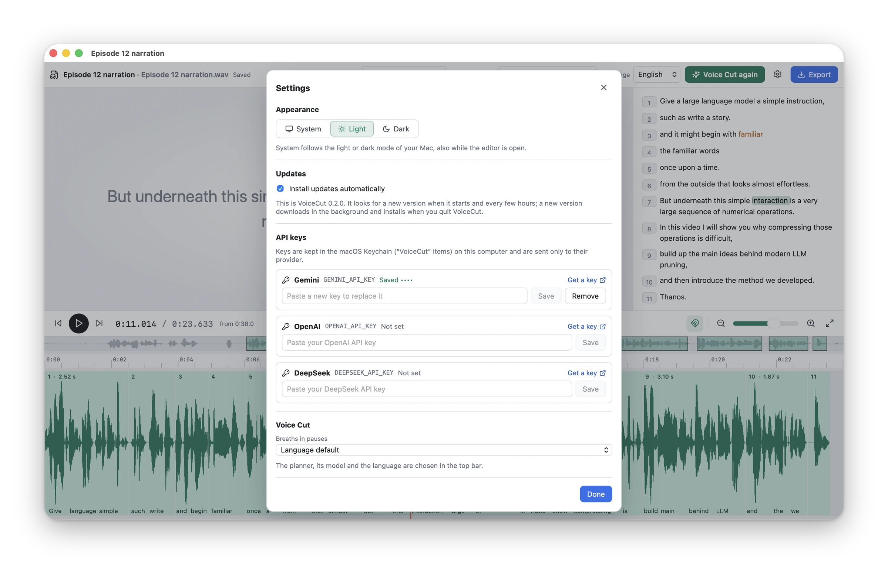
</picture>

## How it works

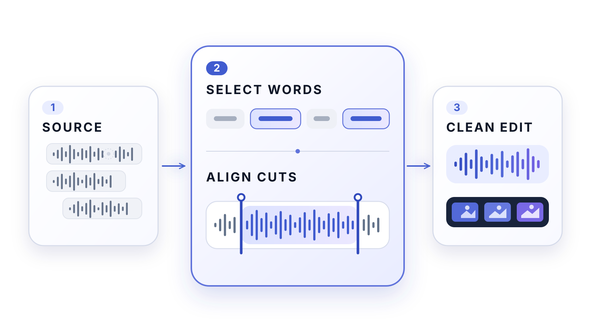

1. **One transcript of everything you said.** Whisper (large-v3-turbo; MLX
   on Apple Silicon, faster-whisper elsewhere) transcribes every speech
   region. Speech that no word covers is transcribed again on its own,
   because Whisper likes to skip repeated phrases.
2. **Takes chosen the way an editor would.** The planner reads about four
   minutes of transcript at a time plus two minutes of look-ahead — with
   Gemini it also hears that audio — and returns the word ranges of the final
   narration and the pause after each sentence. It can revoke a recent choice
   when a better retake comes later, and a final review re-decides any place
   where the edit still repeats itself.
3. **Where every word really starts and stops.** The Montreal Forced Aligner
   maps the kept words to the sound; the waveform's energy then decides
   where each word's sound, including its natural decay, begins and ends. A
   cut never lands inside audible speech.
4. **Natural pauses.** Gaps at cuts and inside kept takes get a length for
   their kind — phrase, comma, sentence, paragraph — and breaths and clicks
   inside them are replaced by clean room tone from the same recording.
5. **One render.** Kept speech is copied sample for sample and joined with
   short crossfades placed in silence; video follows the same source
   intervals with direct picture cuts.
6. **Your corrections.** The editor shows that plan as clips and pauses over
   the original recording and renders your changes with the same renderer.

Every planner answer is checked and retried when invalid, and every request
is cached by its exact content, so an interrupted run resumes where it
stopped. Places where the edit may still repeat itself are reported as
warnings. If the aligner is unavailable, cuts use Whisper's timing refined
by the waveform; if the breath detector fails, pauses are cleaned by
waveform energy alone.

<strong>The whole pipeline</strong>

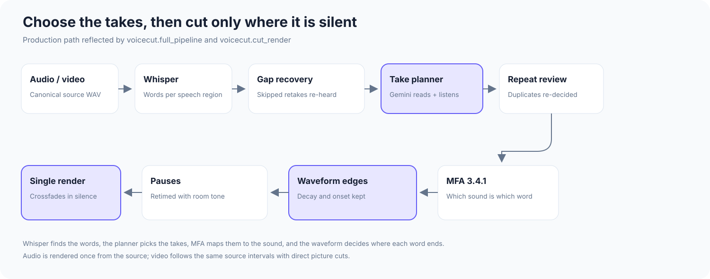

The [architecture guide](docs/architecture.md) has the invariants and the
artifacts of every stage.

## Why VoiceCut is different

| | Silence trimmers and filler-word removers | VoiceCut |
| --- | --- | --- |
| **What it understands** | loudness, or a list of words like "um" | what you meant to say, sentence by sentence |
| **Retakes** | kept, one after another | the best take kept, abandoned attempts removed |
| **Where it cuts** | at a loudness threshold, often clipping words | between words, where the waveform is silent |
| **Pauses** | shortened to one length | a natural length for each kind of pause, filled with your room tone |
| **Your voice** | sometimes regenerated by AI | never synthesized: every sound is from your recording |
| **Afterwards** | a finished file | an editable plan on a timeline, rendered once from the source |

Every kept phrase maps back to exact word occurrences in the recording, and
each project keeps its run's transcript, plan, alignment and final boundary
plan, so you can always see why a cut was made.

## Current limitations

- **Systems:** macOS 14+ (Apple Silicon or Intel), Windows 10/11 on x64 and
  Linux on x86_64 with glibc 2.35+. There are no ARM builds for Windows or
  Linux.
- **Speed without a GPU:** off Apple Silicon and NVIDIA, Whisper runs on the
  CPU at roughly the length of the recording.
- **Recordings:** one main narrator, in English or Russian; choose the
  language in the toolbar. Conversations with overlapping speakers are not
  supported.
- **Cloud planner:** the recommended planners need an internet connection and
  an API key from their provider.
- **Local planner:** it needs about 32 GB of memory and 20 GB of disk: models
  small enough for less (14B parameters or fewer) choose takes far worse. And
  it takes longer than the recording itself: on an M1 Max an hour of
  narration plans in about 1.5–2 hours. Local models read the transcript
  only; Gemini, which also hears the audio, remains the recommended planner.
- **Judgement:** the planner is a language model and can occasionally choose
  the wrong take, and a cut inside tightly connected speech (no pause
  between a kept and a removed word) can sound abrupt. Listen to the edit
  before you publish it.
- **Video:** edited from speech only. VoiceCut does not consider slides,
  gestures, camera changes or visual continuity.
- **Breaths:** breath removal is on by default only for English; the breath
  detector has not been validated for Russian.
- **Unsigned installers:** the first launch needs the steps above, and on
  macOS the "VoiceCut would like to access files in…" questions come back
  once after each update until builds are signed with a Developer ID.
- **First launch** downloads about 1.7 GB on a Mac and 2.9 GB on Windows and
  Linux, and the first Voice Cut about 2 GB more (a local model about 20 GB).

## Command line and development

The same engine runs without the app: `voicecut recording.wav` edits a
recording in the terminal, and `voicecut-editor` opens the editor in a
browser. Both come from a source checkout (macOS on Apple Silicon). See
**[docs/development.md](docs/development.md)** for building from source, the
command line, the browser editor, tests and building the desktop app.

| Guide | Contents |
| --- | --- |
| [Development](docs/development.md) | Source checkout, command line, browser editor, tests, desktop builds |
| [Editor](docs/editor.md) | Clips, pauses, shortcuts, settings and export |
| [Desktop app](desktop/README.md) | How the app installs its engine, documents, updates, signing and releases |
| [Examples](examples/README.md) | The example recordings and how to reproduce them |
| [Architecture](docs/architecture.md) | Production call graph, safety invariants and manifests |
| [Configuration](docs/configuration.md) | Planner backends, languages, caching and command-line options |
| [Troubleshooting](docs/troubleshooting.md) | Model, long-recording and media errors |
| [Contributing](CONTRIBUTING.md) | Development environment, tests and contribution scope |
| [Credits](docs/credits.md) | Upstream projects, models and licenses |

## Built with

VoiceCut builds on
[MLX Whisper](https://github.com/ml-explore/mlx-examples/tree/main/whisper),
[faster-whisper](https://github.com/SYSTRAN/faster-whisper),
[WhisperX](https://github.com/m-bain/whisperX),
[Montreal Forced Aligner](https://montreal-forced-aligner.readthedocs.io/),
[Respiro-en](https://github.com/ydqmkkx/Respiro-en),
[Silero VAD](https://github.com/snakers4/silero-vad),
[FFmpeg](https://ffmpeg.org/) and [Tauri](https://tauri.app/), together with
the planner provider you choose. See
[credits and licensing details](docs/credits.md).

## Star history

## License

VoiceCut is free and open source under the [MIT License](LICENSE).
Third-party models and components keep their own licenses; see
[docs/credits.md](docs/credits.md).
