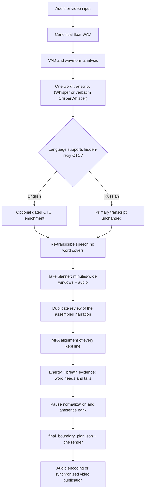

# Architecture

VoiceCut is a source-grounded narration editor. It decides which spoken
attempts should remain, finds where each kept word physically starts and stops
in the waveform, and copies those samples from the original recording. It does
not synthesize replacement words or repeatedly process a chain of rendered
WAVs.

This document describes the current production call graph. For user-facing
options, see [Configuration](configuration.md). For installation, see
[Installation](installation.md).

## Core invariants

1. **The take planner selects source words, not sample coordinates.** It returns
   word-ID ranges and the pause class after each kept sentence.
2. **A cut never lands inside audible speech.** MFA identifies which stretch of
   the waveform is which word; the waveform energy decides where a word's sound
   (including its natural decay) actually ends. Only genuinely connected speech
   is cut at the quietest point next to the phone boundary, with a 4 ms fade.
3. **Every pause is normalized, and pauses contain no breaths.** Gaps at cuts
   and inside kept takes get a class-dependent length; breaths, clicks and other
   non-speech sounds inside a pause are replaced by clean ambience from the
   same recording.
4. **The canonical source WAV is rendered once.** Retained speech samples are
   copied unchanged; joins are equal-power crossfades placed in silence.

## Production flow

The language model participates only in take selection (and, for Gemini, may
listen to a compressed copy of each window's audio). Alignment, waveform
analysis, and media processing remain local.

## 1. Media preparation

FFprobe inspects streams rather than trusting a filename extension. VoiceCut
selects the real audio stream, identifies whether the source includes video,
and records source metadata.

FFmpeg decodes the selected track into a lossless internal float PCM WAV. This
is the canonical source signal used by transcription, alignment, evidence
analysis, and the final renderer. It is not normalized, denoised, mastered, or
otherwise altered before analysis.

For video, the original video remains available for later picture extraction;
the canonical WAV is its speech-analysis track.

## 2. Speech-region analysis

Silero VAD and deterministic waveform features divide long recordings into
manageable speech regions. These regions improve processing and checkpointing,
but they are not sentences, semantic thoughts, or edit boundaries.

Silence and noise-only regions are represented explicitly. A later semantic or
acoustic component cannot infer that a VAD boundary is a safe word cut.

## 3. One primary word transcript

MLX Whisper produces one chronological transcript; with `--asr crisperwhisper`
the verbatim CrisperWhisper 2.0 model produces it instead and keeps quick
restarts as separate words. Every word occurrence has
an immutable ID and approximate start/end times. Repeated words retain distinct
IDs, allowing the semantic planner to choose the later successful occurrence
rather than an identical-looking earlier attempt.

Whisper supplies:

- lexical evidence for take selection;
- chronological word identities;
- approximate anchors used to build alignment crops.

Whisper does **not** supply final sample coordinates.

## 4. Language-specific transcript evidence

VoiceCut supports English and Russian through immutable language profiles.

### English

An optional gated CTC pass searches suspicious transcript geometry for spoken
restart words that a sequence-to-sequence ASR model may have normalized away.
It adds only supported source occurrences. If the optional worker is missing or
one crop fails, VoiceCut records degraded evidence and continues with the
validated primary Whisper transcript. With `--asr crisperwhisper` the pass is
skipped: the verbatim transcript already contains those restarts.

### Russian

The hidden-retry CTC implementation is not validated for Russian. Russian runs
therefore use the primary Whisper transcript directly and record an explicit
language-policy skip instead of fabricating English CTC evidence.

The remaining take-selection, alignment, and rendering stages are the same for
both languages. Russian selects a revision-pinned Russian MFA model.

### Untranscribed speech (both languages)

Whisper's decoder tends to drop text that repeats what it has just written, so
a narrator's third attempt at a phrase can be audible but missing from the
transcript -- and an untranscribed retake between two kept words would be
published. `gap_recovery` finds every speech-level stretch of at least 300 ms
that no transcript word covers, transcribes it on its own, and inserts the
recovered words chronologically. On noise, breaths and mumbling Whisper
confidently hallucinates short phrases ("Thank you.") with one very uncertain
word, so a recovery is accepted only with at least two words, a mean word
probability of at least 0.6 and no word below 0.3.

## 5. Take selection

A human editor hears a whole passage before deciding which attempt survives:
retakes often follow several other sentences, and a speaker may re-read an
entire paragraph minutes later. The planner therefore works on large windows.

- The transcript is split into lines at pauses (>= 250 ms). Each line shows its
  position, the pause before it, and every word with its ID: `[123]word`.
- Each request decides about four minutes (`--window-seconds`, default 240) and
  also shows the next two minutes (`--lookahead-seconds`, default 120) that it
  must not decide. The look-ahead lets the model see that something it is about
  to keep is retaken later.
- With Gemini, the request also carries the audio of exactly that span (a
  normalized 16 kHz MP3; `--planner-audio`). Listening resolves ASR errors
  ("tail weights" -> "stale weights", "and forth" -> "And fourth"), reveals
  stumbles Whisper normalized away, and lets the model pick the take that sounds
  best.
- The answer is a list of items, one per sentence or sentence piece:
  `first_id`, `last_id` (inclusive, contiguous in the source), readable `text`,
  and `break_after` (`none`, `comma`, `sentence`, `paragraph`).
- `resume_from_id` names the first word that should be decided by the next
  request instead (an unfinished sentence at the window end, or one the
  look-ahead may still retake). The next window starts there.
- Each request also shows the last twelve kept items. If the new window holds a
  better retake of one of them, the model revokes it with `drop_previous`.

Validation is structural only: IDs must lie in the editable range and items
must be chronological and non-overlapping. The readable text is never used to
reject an answer, because ASR spellings legitimately differ from what the
speaker meant. An invalid answer is retried with the validation error (three
attempts); transient API errors are retried with backoff. Every request and
response is cached in `04_semantic_plan/calls/`, keyed by the exact prompt and
audio, so an interrupted long run resumes without repeating finished windows.

### Duplicate review

After all windows, a language-agnostic check looks for items that still repeat
each other: similar items within five minutes, a repeated n-gram inside one
item, or words repeated across a join. Each flagged region (bounded to seven
minutes) is re-decided by the model, which sees the raw transcript of the
region, the current edit, the fixed edit around it and the audio. A review can
replace items but cannot empty the region. Suspects that remain are reported as
a pipeline warning.

## 6. Word alignment

Every transcript line that contains a kept word, plus its neighbouring lines,
becomes one MFA context (the line crop padded by up to 300 ms, never into the
neighbouring line). All contexts run in one pinned MFA 3.4.1 `align_hf` batch.
Once the model is in the local cache, MFA runs with `HF_HUB_OFFLINE=1`; on slow
or filtered networks its Hugging Face checks otherwise stall for minutes.

For each word, the span of its first to last non-silence phone becomes its
*core*. Words MFA cannot map keep their Whisper timing, bounded by their
neighbours. If MFA is unavailable altogether, the run continues on Whisper
timing and reports a warning; the energy refinement below still prevents cuts
inside audible speech.

## 7. Heads, tails and dense boundaries

The renderer measures the waveform in 5 ms frames. The noise floor is the 20th
percentile of frames away from words; a frame is *sound* when it is more than
max(6 dB, 20 % of the speech-to-floor range) above the floor, and
*speech-level* when it is within 15 dB of the median word level. Respiro-en
breath probabilities (10 ms frames over the whole recording) mark breaths.

Word edges are only needed where the plan removes source words (a cut):

- **Tail.** Speech-level sound after a word's aligned end always belongs to the
  word -- MFA sometimes ends a word early, and loud speech is never cut. The
  quiet decay that follows is kept until 20 ms of silence or a breath, for at
  most 200 ms, never into the next word's clearly voiced onset (MFA often gives
  a stop consonant's silent closure to the next word, so the search runs to its
  loud onset rather than its MFA start). The cut point sits 12 ms inside the
  silence, so the crossfade lies in silence.
- **Head.** Mirror image: loud sound before the aligned start belongs to the
  word, then soft onsets are kept for at most 120 ms, stopping at silence, a
  breath, or the previous word.
- **Dense boundary.** Only when the sound runs into the neighbouring removed
  word without any quiet is the boundary connected speech. The cut is then
  placed at the quietest frame within about 15 ms of the MFA boundary, with a
  4 ms fade -- the only place retained samples are faded. A decay that merely
  reaches its 200 ms limit is not connected speech; it is faded out over 30 ms.

## 8. Pauses

Kept words that are adjacent in the source form one take. Inside every take,
pauses are found from the waveform rather than from word timing, because an
aligner occasionally packs words into a silent hesitation. Speech is every
speech-level stretch longer than a click (40 ms), plus its decay (200 ms) and
soft onset (120 ms); neither extends through a breath. Everything else --
silence, breaths, faint noise, clicks -- is pause material, and every stretch
of at least 180 ms is a pause.

| Class | Minimum | Target | Maximum |
| --- | ---: | ---: | ---: |
| `none` | 0 ms | 100 ms | 220 ms |
| `comma` | 120 ms | 280 ms | 450 ms |
| `sentence` | 350 ms | 500 ms | 750 ms |
| `paragraph` | 650 ms | 850 ms | 1200 ms |

The class of a pause is the `break_after` of the kept word just before it
(the planner's `break_after` for an item's last word; inside an item, the
punctuation of the planner's text aligned to the source words).

- A pause that is clean (no sound, no breath) and no longer than its class
  maximum is kept untouched.
- A longer one is shortened to the target; a noisy one keeps its length (at
  least the class minimum) but its content is replaced.
- At a cut the silence between the two words becomes the class target.

A shortened or cleaned pause is rebuilt from clean original silence next to
each word, then ambience. Ambience comes from a bank of clean runs (>= 250 ms,
within 3 dB of the floor, away from words, sounds and breaths), nearest to the
join first, assembled with 30 ms crossfades. Pieces are overlap-added with
10 ms equal-power crossfades that lie in silence.

Video uses the `cuts` policy: no ambience is inserted and every pause is built
from original silence only, so pictures can follow the same source intervals.

## 9. Boundary plan, render and publication

`05_final/final_boundary_plan.json` records the signal statistics, the
alignment of every word, every join (class, original and desired gap, tail and
head extensions, silence and ambience used), the overlap-added pieces, and a
disjoint output trace in which each source segment maps one output sample to
one source sample. The renderer writes one internal `final_cut.wav`; audio
publication encodes it once into the requested format, and video publication
applies the trace to the original pictures.

## 10. Interactive correction (VoiceCut Editor)

The browser editor does not add a second pipeline. `voicecut-editor` runs the
same `run_full_pipeline` entry point in a worker process, reports its stages
over Server-Sent Events, and then reads the immutable `final_boundary_plan.json`
to derive a small editor proposal: the ordered `source_intervals` with their
fades, the room tone at every join, and the transcript words. The browser lays
the timeline out with a port of the exporter's own piece arithmetic, so every
clip sits exactly where it lands in the output, and edits stay a ripple edit
over the original recording.

Human edits are stored separately as `timeline.json` (segments with
`voicecut`, `manual` or `source` boundary origins). The server derives
`cut_render` pieces from that timeline, keeping VoiceCut's fades and pauses at
every untouched boundary and a short declick crossfade at manual ones. Preview
playback streams any stretch of those pieces rendered with the same
overlap-add arithmetic; export renders them once and publishes through
`publish_audio` or `render_edited_video`. An unmodified timeline reuses
VoiceCut's own published result. See [Editor](editor.md) for the design.

## Work-directory artifacts

| Path | Purpose |
| --- | --- |
| `pipeline_config.json` | Immutable input/configuration identity and implementation fingerprint |
| `00_media/` | Canonical source WAV and media-stream manifest |
| `01_analysis/` | VAD and waveform analysis |
| `02_transcription/` | Primary word transcript and resumable checkpoints |
| `03_ctc_enrichment/` | English CTC evidence or Russian language-policy skip report |
| `03_gap_recovery/` | Transcript with re-transcribed uncovered speech and its region report |
| `04_semantic_plan/` | `take_plan.json` (items, windows, review ledger) and `calls/` request cache |
| `05_final/` | MFA batch, `final_boundary_plan.json`, `final_render_manifest.json`, `final_cut.wav` |
| `06_publication/` | Audio or video publication manifest |
| `pipeline_run.json` | Final stage/cache ledger and warnings |

## Cache identity and immutability

The default work directory is content-addressed. Its configuration records the
input hash, selected language profile, planner backend, model and audio policy,
alignment and breath settings, runtime paths, and a hash of production Python
source. Each stage validates both artifact content and provenance before reuse.
An explicit work directory is locked against concurrent writers and rejected
when it belongs to a different configuration.

## Failure-policy summary

| Condition | Policy |
| --- | --- |
| Optional English CTC unavailable | Continue with primary Whisper transcript and warning |
| Russian CTC | Explicitly skipped by language policy |
| Planner answer invalid | Retry with the validation error, up to three attempts; then stop with an error (finished windows stay cached) |
| Transient API error | Retry with backoff |
| Repetition left after the review | Publish and warn with the locations |
| MFA unavailable | Whisper timing refined by the waveform, with a warning |
| Breath detector unavailable | Energy-only pause cleaning, recorded in the manifest |
| No clean ambience in the recording | Pauses use original silence only |
| Hash, ID or source geometry corruption | Fail closed |
